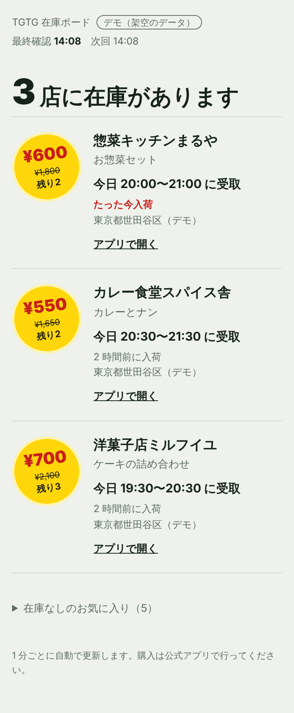
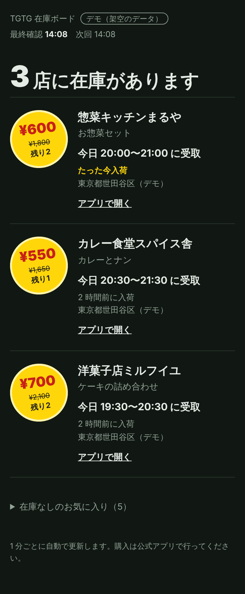
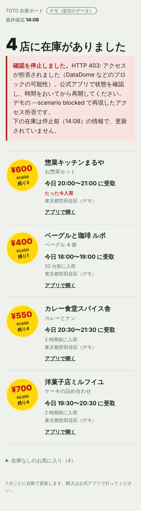

# tgtg-jp

[](https://github.com/masteren/tgtg-jp/actions/workflows/test.yml)

フードロス削減アプリ [Too Good To Go](https://www.toogoodtogo.com/ja)（以下 TGTG）のお気に入り店舗を定期的に確認し、
「サプライズバッグ」の在庫を 1 ページの**在庫ボード**にまとめる個人用ツールです。
購入は自動化せず、本人が公式アプリで購入します。

<p>
  
  
  
</p>

左から、在庫ボード（ライト／ダーク）と、アクセス拒否を受けて確認を停止したときの表示です。
画像はすべてデモモードの架空データです。

## 現状と調査結果（2026 年 10 月）

**日本では現在、本番モードで在庫を取得できません。** ツールはその状態を検知し、安全に停止します。

| 確認したこと | 結果 |
| --- | --- |
| アプリ用 API へのログイン | クラウドサーバー（東京）と自宅回線の両方で HTTP 403 |
| 403 の原因 | 公式アプリは内蔵の DataDome SDK で端末を検証し、その証明（Cookie）を付けて通信する。スクリプトにはそれがない |
| ログイン不要の公開ページ | 海外向けサイトには店舗ごとの在庫ページがあるが、日本向けサイトには見当たらない。共有リンクはアプリのダウンロード案内のみ |

依存ライブラリ tgtg-python には、端末情報を生成して DataDome の Cookie を取得する機能があります。
これはボット対策の回避にあたるため、本ツールでは**意図的に無効化**しています（`tgtg_jp/client.py`）。
回避せずに使える経路がない以上、アクセス拒否を受けたら止まる、というのが本ツールの仕様です。
在庫の通知には、公式アプリのお気に入り店舗の通知機能を使ってください。

## デモ

ログインも設定ファイルも不要で、架空の東京の店舗データを使って本番と同じコードを動かせます。

```bash
python3 -m venv .venv && .venv/bin/pip install -r requirements.txt
.venv/bin/python -m tgtg_jp demo                      # http://localhost:8787/
.venv/bin/python -m tgtg_jp demo --scenario blocked   # 4 回目の確認で 403 → 停止
.venv/bin/python -m tgtg_jp demo --scenario ratelimit # 429 → 待機して自動復帰
```

デモで差し替えるのは API クライアントだけです。ポーリング、入荷の追跡、エラー処理、在庫ボードは本番と同じコードが動きます。
10 秒ごとに入荷・売り切れ・再入荷が起き、ボードは 1 分ごとに自動更新されます。

## 設計

- **入荷の追跡**　在庫が「なし → あり」になった時刻を記録し、売り切れたら記録を消します。
  再入荷や翌日分は新しい入荷として扱い、記録はファイルに保存するため再起動しても保たれます。
- **アクセス制御を尊重**　401/403 を受けたら確認を止め、理由をボードに表示します（ボード自体は表示を続ける）。
  systemd には終了コード 2 で人の対応が必要なことを伝え、自動再起動させません。
- **控えめなポーリング**　間隔は 60 秒以上に制限し、ランダムなゆらぎと夜間の静音時間帯を設定可能。
  429 は指数バックオフ、通信エラーは段階的に待機して再試行します。
- **依存を増やさない Web**　標準ライブラリの `ThreadingHTTPServer` で配信します。監視スレッドと Web スレッドは、
  不変オブジェクト `Status` をロックの中で差し替えるだけで状態を共有します。
- **安全な既定値**　ボードは既定で 127.0.0.1 のみで待ち受け、外部公開には 12 文字以上のパスワード（Basic 認証）が必須です。
  CSP などのセキュリティヘッダーを付け、店舗名などの外部データはすべてエスケープします。
  トークンは権限 0600 で保存し、ログやエラーにトークン・レスポンス本文を出しません。

```
tgtg_jp/
├── __main__.py   CLI（login / favorites / run / demo / test-notify）
├── config.py     設定の読み込みと検証
├── client.py     API クライアント、エラー分類、トークン保存
├── watcher.py    レスポンス解析と入荷の追跡（純粋なロジック）
├── monitor.py    ポーリング、バックオフ、静音時間帯、状態の共有
├── web.py        在庫ボード（HTML / JSON）
├── demo.py       デモ用の架空データとシナリオ
└── notify.py     Discord Webhook（任意）
```

## テスト

```bash
.venv/bin/pip install pytest
.venv/bin/python -m pytest -q
```

TGTG API と Discord はモックに置き換えており、外部には接続しません（Web サーバーのテストのみ 127.0.0.1 で待ち受けます）。
GitHub Actions で Python 3.10 / 3.12 のテストを実行しています。

## 本番モード（参考）

API にアクセスできる環境向けの手順です。上記のとおり、日本では現在ログインの段階で停止します。

```bash
cp config.example.yaml config.yaml          # email を設定
.venv/bin/python -m tgtg_jp login           # メールの PIN を入力
.venv/bin/python -m tgtg_jp favorites       # お気に入りと item_id を表示
.venv/bin/python -m tgtg_jp run             # 監視と在庫ボードを開始
```

常駐させる場合は `deploy/tgtg-jp.service` を systemd に登録します。ボードはサーバー内部でのみ待ち受けるため、
`ssh -N -L 8787:127.0.0.1:8787 <サーバー>` で手元から開きます。Discord に通知する場合は環境変数
`DISCORD_WEBHOOK_URL` を設定してください。

> 非公式 API を利用しており、TGTG とは無関係です。自動アクセスは同社の利用規約に抵触する可能性があります。

## ライセンス

GPL-3.0（依存ライブラリ tgtg-python のライセンスに合わせています）
